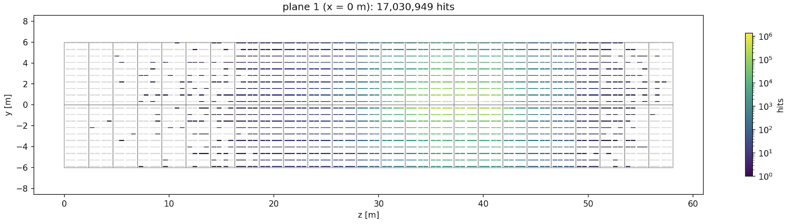
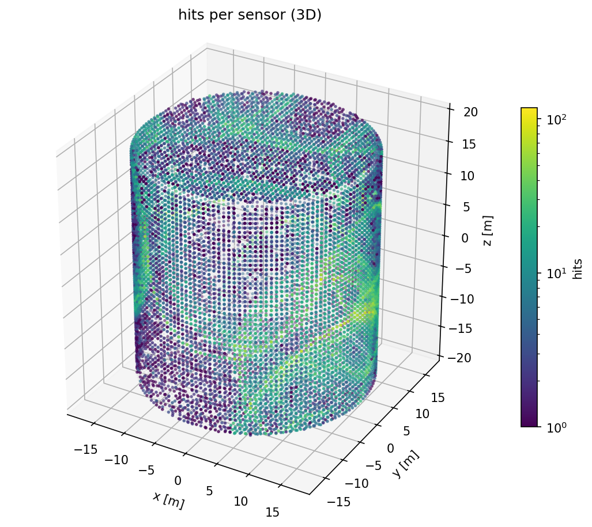
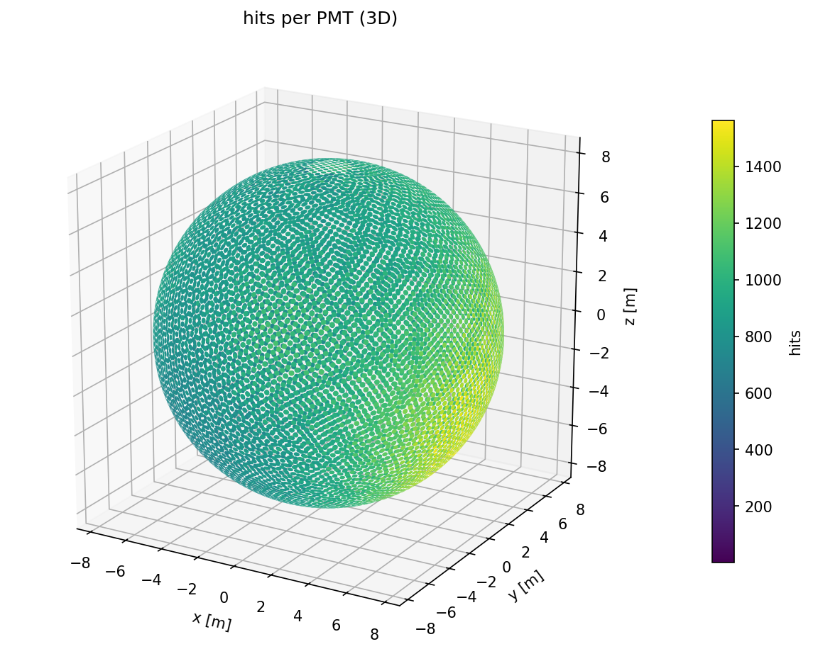
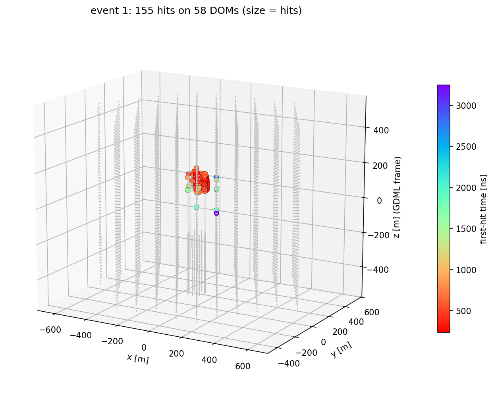

# OpticalSims: Geant4 + GDML + RiceOpticks

**Take any detector geometry, run the same events with CPU and GPU optical photon simulation, and find out what RiceOpticks buys you.**

## Overview

OpticalSims is a **hybrid CPU–GPU simulation environment** built on:

- **[Geant4](https://geant4.web.cern.ch/)** for particle transport and detector simulation.
- **[RiceOpticks](https://github.com/nuRiceLab/RiceOpticks)** for optical photon propagation on NVIDIA GPUs. It is built on [Opticks](https://bitbucket.org/simoncblyth/opticks/src/master/) and NVIDIA OptiX.

Geant4 still handles every particle on the CPU. Scintillation and Cherenkov photons, usually the most expensive part of an event by far, can be handed to the GPU instead. The detector is read from a **GDML file at run time**, so no C++ is written per experiment. If a geometry can be described in GDML with optical properties and tagged sensors, OpticalSims can simulate it on the CPU, on the GPU, or both, from the same macro.

That makes this repository a **test bench for RiceOpticks on any experiment**:

| Question | How OpticalSims answers it |
|---|---|
| How much faster is GPU optical simulation for *my* detector? | Run the same macro with `OPTICKS_INTEGRATION_MODE=2` (Geant4 CPU) and `=1` (RiceOpticks GPU), then compare the per-event times in the `PhotonInfo` tree. |
| Does the GPU give the same physics? | Use `OPTICKS_INTEGRATION_MODE=3` to run both in each event, then compare the `Geant4Hits` and `OpticksHits` trees sensor by sensor. |
| How does the speed-up scale with light yield, detector size or sensor count? | Swap the GDML or macro (particle, energy, number of events) and rerun. The physics list and output stay the same. |
| Is my geometry ready for GPU simulation? | Load it. Opticks converts the whole geometry, materials and surfaces at start-up and reports anything it cannot translate. |

The same workflow already runs on liquid-argon TPCs (DUNE, ProtoDUNE, ICARUS), water Cherenkov detectors (Super-Kamiokande), liquid-scintillator detectors (SNO+) and an ice Cherenkov telescope (IceCube). See [Included geometries](#-included-geometries).

---

## ⚙️ Prerequisites

- **CUDA Toolkit 13 Update 2** (tested)
- **NVIDIA GPU with OptiX 9 support** (tested)
- **Geant4**, with GDML support enabled
- **RiceOpticks / Opticks**
- **ROOT**, for output and visualization

All of these come preinstalled in the RiceOpticks container, which is the recommended route.

---

## 📦 Installation using the RiceOpticks container

More information about the container: <https://github.com/nuRiceLab/riceopticks-container>

```bash
# The image is large. Put the Apptainer cache somewhere with space:
# HPC home directories usually do not have enough.
mkdir -p cache/.apptainer/tmp
export APPTAINER_CACHEDIR=$PWD/cache/.apptainer
export APPTAINER_TMPDIR=$PWD/cache/.apptainer/tmp

apptainer pull riceopticks_v1.0r.sif oras://ghcr.io/nuricelab/riceopticks:v1.0r
apptainer shell --nv --bind /cvmfs riceopticks_v1.0r.sif

# inside the container
source /opt/opticks-dev-env.sh
git clone https://github.com/nuRiceLab/OpticalSims
cd OpticalSims
source configure.sh      # configures a fresh build/ directory and cd's into it
make -j2
```

## 🛠️ Manual installation

```bash
git clone https://github.com/nuRiceLab/OpticalSims
cd OpticalSims
mkdir build && cd build
cmake -DWith_Opticks=true -DWITH_GEANT4_VIS=true ..
make -j2
```

---

## 🚀 Running

Run everything below from `build/`.

### 1. Set the Opticks environment

```bash
source ../OpticksEnv        # Opticks defaults: max photons, bounces, integration mode, ...
```

### 2. Batch mode

```bash
./gdml_det ../GDML/dune10kt_v5_refactored_1x2x6_nowires_NoField.gdml ../macros/g04.mac
```

The usual Geant4 commands (`/gps/...`, `/run/beamOn`) go in the macro. Set the output file with `/RunAction/output/file <name>.root`.

---

## ⚖️ Comparing CPU and GPU optical simulation

The integration mode decides who propagates the optical photons:

| `OPTICKS_INTEGRATION_MODE` | Optical photons simulated by | Use it to |
|---|---|---|
| `1` | **GPU only** (RiceOpticks) | measure GPU throughput |
| `2` | **CPU only** (Geant4) | get the reference CPU time and hits |
| `3` | **both**, in the same event (default in `OptickEnv`) | validate GPU hits against Geant4 hit by hit |

A typical benchmark for a new geometry:

```bash
source ../OptickEnv; export LC_ALL=C GEOM=MyDetector
export OPTICKS_INTEGRATION_MODE=2; ./gdml_det ../GDML/MyDetector.gdml ../macros/MyDetector.mac   # CPU reference
export OPTICKS_INTEGRATION_MODE=1; ./gdml_det ../GDML/MyDetector.gdml ../macros/MyDetector.mac   # GPU
export OPTICKS_INTEGRATION_MODE=3; ./gdml_det ../GDML/MyDetector.gdml ../macros/MyDetector.mac   # validation
```

Give each run its own `/RunAction/output/file`. Speed comparisons should use modes 1 and 2: in mode 3 the event time includes both simulations.

Other useful knobs in `OptickEnv`:

- `OPTICKS_MAX_PHOTON`: GPU photon budget per launch. Raise it for high-energy events in large detectors.
- `OPTICKS_MAX_BOUNCE`: maximum number of steps per photon.
- `OPTICKS_EVENT_MODE`: `Minimal` keeps only what the ROOT output needs; `Hits` also writes `.npy` debug arrays.
- `CUDA_VISIBLE_DEVICES`: chooses the GPU.

### Output (ROOT file)

| Tree | Contents |
|---|---|
| `generator` | primary particle: `name`, `pdg`, `energy`, vertex `ix,iy,iz,it`, direction `mx,my,mz`, `evtID` |
| `OpticksHits` | GPU hits: `evtID`, `hit_Id`, `SensorID`, `x,y,z,t`, `wavelength`, `boundary` |
| `Geant4Hits` | CPU hits: `evtID`, `SensorID`, `SensorName`, `x,y,z,t`, `wavelength`, `ProcessID` |
| `PhotonInfo` | photons generated per event: `G4ScintPhotons`, `G4CernPhotons`, `OScintPhotons`, `OCerenkovPhotons`, wall-clock event `Time` [s], `eventID`, `BatchID` |
| `step` | optional particle step record |

---

## 🧩 Bring your own geometry

RiceOpticks only needs a GDML file. To make a detector GPU-ready:

1. **Give every optical medium a material properties table.**
   - `RINDEX`, `ABSLENGTH` and (optionally) `RAYLEIGH` as functions of photon energy.
   - A volume whose material has no `RINDEX` absorbs photons, both in Geant4 and in Opticks.
2. **Scintillators need both naming schemes.**
   - Geant4 11 names: `SCINTILLATIONYIELD`, `RESOLUTIONSCALE`, `SCINTILLATIONCOMPONENT1..3`, `SCINTILLATIONTIMECONSTANT1..3`, `SCINTILLATIONYIELD1..3`.
   - The arrays Opticks reads for GPU generation: `FASTCOMPONENT`, `SLOWCOMPONENT` (identical emission spectra) and `REEMISSIONPROB`.
3. **Tag the sensors.**
   - Add `SensDet = PhotonDetector` to every sensitive logical volume.
   - Add an `<opticalsurface>` with an `EFFICIENCY` table, attached through a `Surface` auxiliary. It becomes a skin surface, or a border surface if its name contains `Border`.
4. **Sensor IDs.** If the sensor's logical-volume name has **no `_`**, each placement's copy number becomes its `SensorID`. This is the easiest choice for thousands of identical PMTs, DOMs or SiPM tiles.

```xml
<opticalsurface name="MyPMTSurface" model="unified" finish="polished" type="dielectric_metal" value="0">
  <property name="EFFICIENCY"   ref="PMT_EFFICIENCY"/>
  <property name="REFLECTIVITY" ref="PMT_REFLECTIVITY"/>
</opticalsurface>
...
<volume name="volPMT">                       <!-- no '_' : copy number = SensorID -->
  <materialref ref="G4_Galactic"/>
  <solidref ref="PMTSolid"/>
  <auxiliary auxtype="SensDet" auxvalue="PhotonDetector"/>
  <auxiliary auxtype="Surface" auxvalue="MyPMTSurface"/>
</volume>
```

---

## 🗺️ Included geometries

| Detector | Type | GDML | Light |
|---|---|---|---|
| DUNE FD-HD 10 kt (full and 1×2×6) | LArTPC | `GDML/dune10kt_v6_refactored*.gdml` | LAr scintillation |
| DUNE FD-VD 10 kt | LArTPC | `GDML/dunevd10kt_fullvd_wires.gdml` | LAr scintillation |
| ProtoDUNE-HD | LArTPC | `GDML/protodunehd_v*_refactored*.gdml` | LAr scintillation |
| ICARUS | LArTPC | `GDML/icarus_complete_*_overburden*.gdml` | LAr scintillation |
| Super-Kamiokande like | water Cherenkov, 11 096 PMTs | `GDML/SK-like_opticks.gdml` | Cherenkov |
| SNO+ like | liquid scintillator (LAB + PPO), 9 362 PMTs | `GDML/SNOplus-like_opticks.gdml` | scintillation + Cherenkov |
| IceCube-86 like | ice Cherenkov telescope, 5 160 DOMs | `GDML/IceCube86-like_opticks.gdml` | Cherenkov |

---

## 📊 Analysis

The Jupyter notebooks in `Analysis/` use `uproot` and `matplotlib`:

- `OpticksHits_general.ipynb`: hits per sensor and 3-D heat maps for **any** GDML geometry, with box-shaped sensors such as DUNE, ICARUS or SiPM arrays. Start here for a new detector.
- `OpticksHits_heatmap.ipynb`, `OpticksHits_SNOplus.ipynb`, `OpticksHits_IceCube86.ipynb`: geometry-specific versions with unrolled-barrel, sphere-projection and string-by-depth views, plus event displays.

See some examples:






## 🩺 Troubleshooting

- **Run aborts with `locale::facet::_S_create_c_locale name not valid`.** Fix: `export LC_ALL=C`.
- **No optical photons in a water or ice detector.** Cherenkov generation is off by default. Enable it with `export G4CerenkovOpticks__ENABLE=1`.
- **Geometry changed but the GPU still sees the old one.** Use a new `GEOM` name, or delete `~/.opticks/GEOM/$GEOM`.
- **Large events are truncated.** Increase `OPTICKS_MAX_PHOTON` (and `OPTICKS_MAX_SLOT`) to cover the photons generated per event.

## Citation

If you use this work, please cite:

```bibtex
@misc{parmaksiz2026acceleratingopticalphotonsimulation,
      title={Accelerating Optical Photon Simulation in DUNE with Opticks},
      author={Ilker Parmaksiz and Aaron Higuera and Laura Paulucci and Viktor Pec and Estanislao Forino},
      year={2026},
      eprint={2608.27306},
      archivePrefix={arXiv},
      primaryClass={hep-ex},
      url={https://arxiv.org/abs/2608.27306},
}
```
